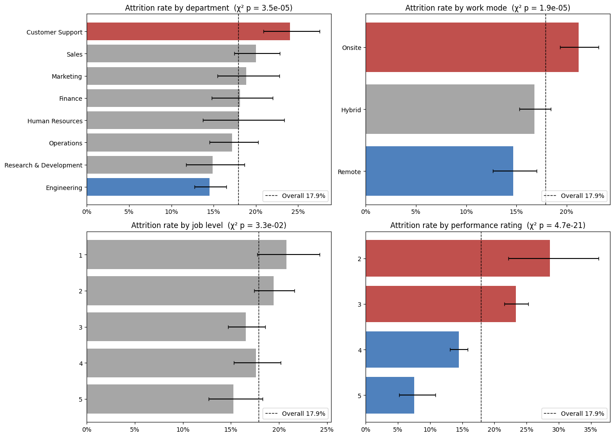
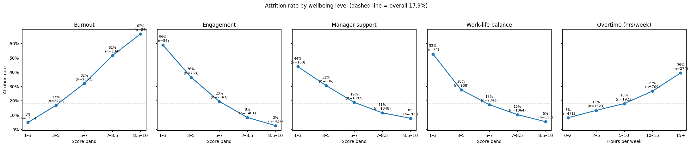
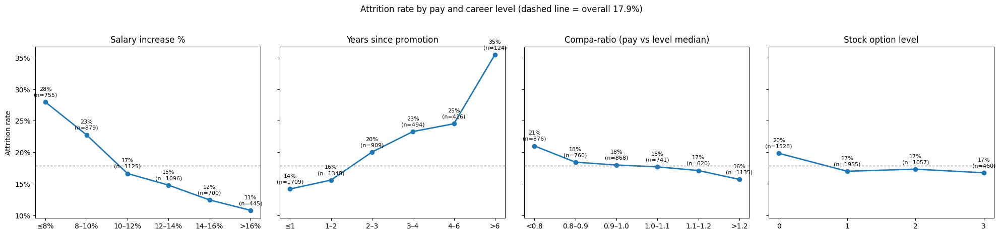
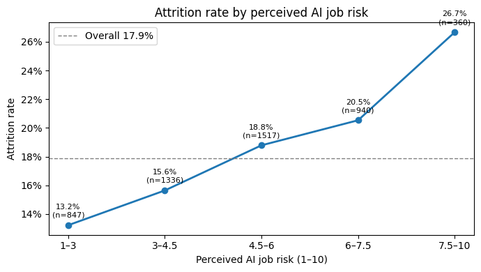
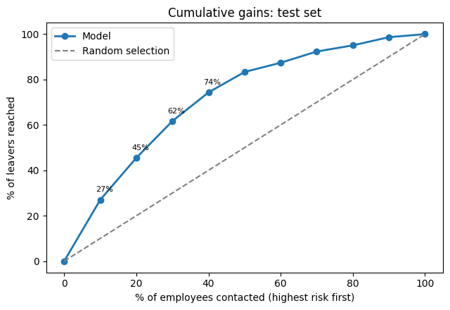
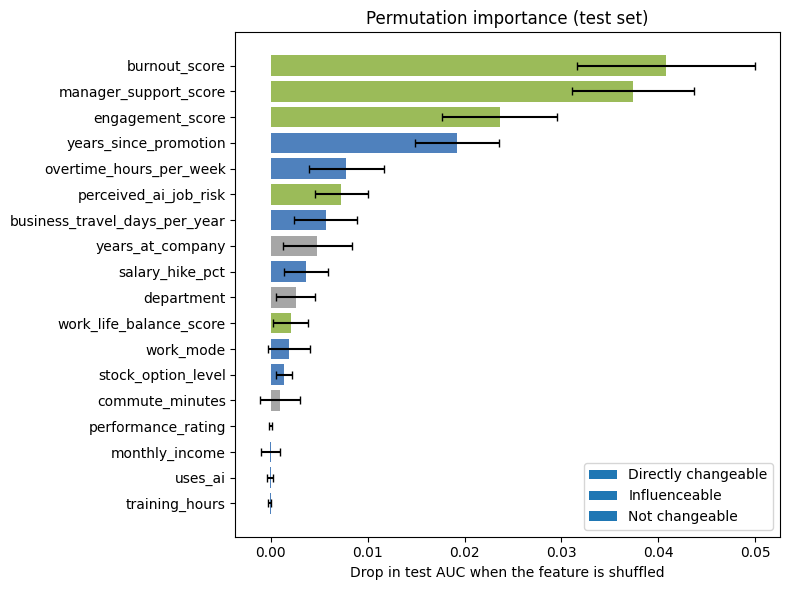
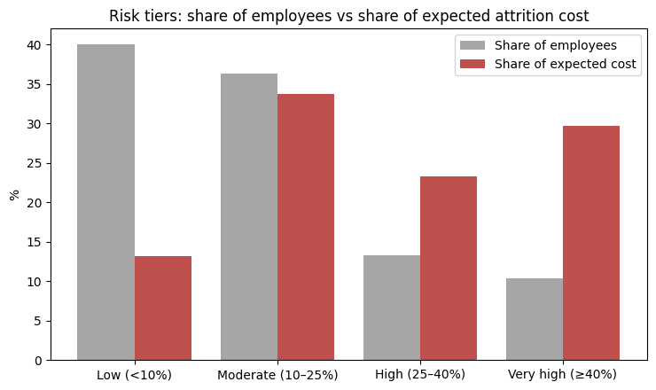
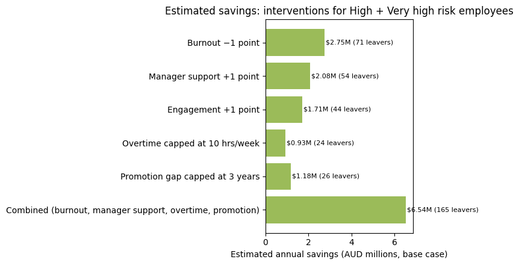
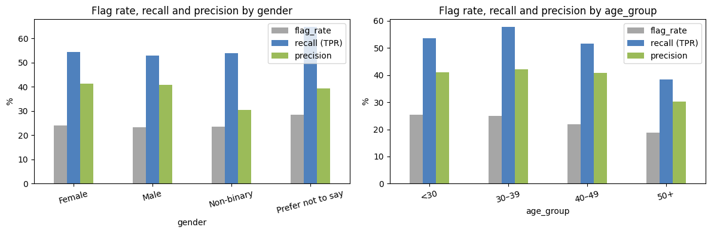

# HR Analytics: Workforce, Turnover and Attrition Risk

End-to-end HR analysis in two parts: workforce and turnover reporting in **SQL (BigQuery)**, and attrition drivers and risk modelling in **Python**.

In this project, I cleaned and validated two HR datasets, then analysed them to answer business questions about headcount, turnover trends, exit reasons, hiring channels, manager effects, regretted attrition, pay equity, the drivers of attrition, and what reducing it would be worth.

> **Note on the data:** Part A and Part B use **two separate datasets from different sources**. They describe different (fictional) organisations and are **not linked** in any way. I combined them into one project only to show how I would approach HR analysis end to end, from descriptive workforce reporting to predictive modelling. Each part should be read on its own.

**Tools:** BigQuery SQL (Part A) · Python (pandas, NumPy, SciPy, statsmodels, scikit-learn, Matplotlib, Seaborn) in Google Colab (Part B)

**SQL Scripts (Part A):** [Click Here](./part_a_sql/)

**Looker Data Studio Dashboard (Part A visualization):** [Click Here]([https://datastudio.google.com/reporting/f82aa9d6-b59f-4dd6-bf98-dce19a5d0149](https://datastudio.google.com/s/sPlUDnmog1U))

**Python Notebook (Part B):** [Click Here](./part_b_python/HR_Analysis.ipynb)

---

## Contents

- [HR Analytics: Workforce, Turnover and Attrition Risk](#hr-analytics-workforce-turnover-and-attrition-risk)
  - [Contents](#contents)
  - [Business questions](#business-questions)
  - [Executive summary](#executive-summary)
  - [Datasets](#datasets)
  - [Data cleaning and validation](#data-cleaning-and-validation)
    - [Part A issues and how they were handled](#part-a-issues-and-how-they-were-handled)
    - [Part B issues and how they were handled](#part-b-issues-and-how-they-were-handled)
  - [Key definitions](#key-definitions)
  - [Methodology](#methodology)
  - [Findings: Part A (SQL)](#findings-part-a-sql)
    - [A1. Workforce profile](#a1-workforce-profile)
    - [A2. Turnover trend](#a2-turnover-trend)
    - [A3. Why people leave](#a3-why-people-leave)
    - [A4. Recruitment source quality](#a4-recruitment-source-quality)
    - [A5. Manager effect](#a5-manager-effect)
    - [A6. Performance, engagement and exits](#a6-performance-engagement-and-exits)
    - [A7. Pay equity](#a7-pay-equity)
  - [Findings: Part B (Python)](#findings-part-b-python)
    - [B1. Attrition profile](#b1-attrition-profile)
    - [B2. Wellbeing drivers](#b2-wellbeing-drivers)
    - [B3. Pay and career progression](#b3-pay-and-career-progression)
    - [B4. Work arrangements and AI](#b4-work-arrangements-and-ai)
    - [B5. Attrition risk model](#b5-attrition-risk-model)
    - [B6. Drivers: what matters and what can be changed](#b6-drivers-what-matters-and-what-can-be-changed)
    - [B7. Business impact](#b7-business-impact)
    - [B8. Fairness check](#b8-fairness-check)
  - [Recommendations](#recommendations)
  - [Limitations](#limitations)
  - [Repository structure](#repository-structure)

---

## Business questions

**Part A: Workforce and turnover (SQL)**

1. **Workforce profile:** What does headcount look like each year, and how many people were hired vs left?
2. **Turnover trend:** Is turnover rising or falling, and where is it concentrated?
3. **Exit reasons:** Why do people leave, and how many exits could the company have prevented?
4. **Recruitment source:** Which hiring channels bring people who stay and perform well?
5. **Manager effect:** Do some managers lose far more people than others with similar teams?
6. **Performance and exits:** Are we losing strong performers or mostly weaker ones?
7. **Pay equity:** Is pay fair by sex, overall and within the same position?

**Part B: Attrition drivers and risk (Python)**

1. **Attrition profile:** Which groups leave most, and are the differences meaningful?
2. **Wellbeing:** How much do burnout, engagement, manager support and overtime explain exits?
3. **Pay and career:** Do people leave because of pay or stalled careers?
4. **Work arrangements and AI:** Do work mode, commute and perceived AI job risk affect attrition?
5. **Risk model:** Can we identify at-risk employees early enough to act?
6. **Drivers:** Which factors matter most, and which can the company change?
7. **Business impact:** What does attrition cost, and what would targeted action save?
8. **Fairness:** Does the model work equally well across gender and age?

---

## Executive summary

| Area | Headline |
|---|---|
| **Headcount (A)** | Peaked at **229 in 2015** and fell to 207 by 2018. **Hiring nearly stopped after 2016** (1 hire in 2018) while exits continued. |
| **Turnover (A)** | Averages **7.2% a year**, with a spike to 10.3% in 2015. **Production loses people at 2.7× the rate of Sales** (8.3% vs 3.1%) and accounts for 80% of exits. |
| **Exit reasons (A)** | **51% of exits were controllable** (pay, hours, unhappiness, a better offer), and every "unhappy" and "more money" exit came from Production. |
| **Hiring channels (A)** | After adjusting for role and timing, **Google Search is the weakest channel** (71% retained after 3 years); **referrals and LinkedIn are the strongest** (93% and 90%). |
| **Managers (A)** | With near-identical teams, **3 of 9 Production managers lost far more people than expected**, but for different reasons. |
| **Regretted attrition (A)** | **77% of exits were strong performers who chose to leave.** Engagement scores didn't flag them. |
| **Pay equity (A)** | The overall gap is 1.5–2.0%, but **like for like it's −0.5%**. The gap comes from more women working in lower-paid Production roles. |
| **Drivers (B)** | **Burnout, manager support and stalled promotions** drive attrition far more than pay level or demographics. |
| **Risk model (B)** | A logistic regression (AUC 0.769) finds **45.5% of leavers in the riskiest 20%** of employees. |
| **Cost (B)** | Attrition costs about **$35.5M a year**; a targeted package for the highest-risk 23.7% could save about **$6.54M a year**. |

**Top priorities:** retain experienced Production staff (pay, hours, career path), track regretted attrition as its own KPI, shift hiring budget to referrals and LinkedIn, reduce burnout and invest in managers, and use the risk model to target retention where it matters most.

---

## Datasets

| | Part A | Part B |
|---|---|---|
| **Dataset** | [HRDataset_v14](https://www.kaggle.com/datasets/rhuebner/human-resources-data-set) (Kaggle, Huebner & Patalano) | [Employee Attrition and HR Analytics 2026](https://www.kaggle.com/datasets/uditjain13/employee-attrition-and-hr-analytics-2026) (Kaggle) |
| **Rows** | 311 employees, 36 columns | 5,000 employees (895 leavers) |
| **Time period** | Hires 2006–2018, data up to Feb 2019 | Single snapshot (no dates) |
| **Contents** | Hire and exit dates, exit reasons, department, position, manager, recruitment source, performance, engagement, salary | Wellbeing scores, pay and promotion history, work mode, commute, AI job risk, performance |
| **Tool** | BigQuery SQL | Python | Looker Data Studio |

---

## Data cleaning and validation

### Part A issues and how they were handled

| Issue | Rows | Action |
|---|---|---|
| Trailing and double spaces in `Department`, `Sex` and names (`'Production       '`, `'M '`) | 209 / 135 / 88 | Trimmed |
| `Data Analyst ` with a trailing space, appearing as a separate position | 1 | Trimmed, so it merges with `Data Analyst` |
| Two-digit birth years read as 2050s–2060s instead of 1950s–1960s | 42 | Moved back 100 years when the date was in the future |
| Blank `ManagerID` | 8 | Filled from the same manager's other rows (Webster Butler = 39) |
| `DeptID` doesn't match `Department` (e.g. Production coded as Sales) | 2 | Rebuilt the code from the text column |
| `EmpStatusID` doesn't match `EmploymentStatus` (Active coded 2/3, dismissals coded 1) | 27 | Rebuilt the code from the text column |
| `PerfScoreID` doesn't match `PerformanceScore` | 2 | Rebuilt the code from the text column |
| Zip codes lost their leading zero (01960 → 1960) | 287 | Padded back to 5 digits |
| 17 free-text exit reasons with mixed capitalisation | 104 | Lowercased and grouped into 4 categories |
| Review date after termination date | 1 | Kept, flagged in A6 |

I also wrote a **data dictionary** for all 36 columns, including what every code means (e.g. `EmpStatusID` 1 = Active, 4 = Terminated for Cause, 5 = Voluntarily Terminated). No duplicate employees were found (311 rows, 311 unique IDs).

### Part B issues and how they were handled

I ran **15 sanity checks** on structure, valid ranges and logic between columns. 7 passed; 1,358 employees (27.2%) have at least one flag.

| Issue | Rows | Action |
|---|---|---|
| Tenure longer than total working years (impossible) | 59 | Excluded from analyses using tenure or working years |
| 0 prior companies but worked elsewhere | 604 | `num_prior_companies` treated with caution, not used in the model |
| More prior employers than years worked | 40 | Same as above |
| Manager/Lead roles at levels 1–2, non-managers at level 5 | 635 | `job_level` used for seniority, `job_role` for type of work, never combined |
| PhDs under 26, Masters under 23 | 106 | Kept (rare but possible) |
| Rated "below expectations" but review score 9+ | 20 | Both kept, analysed separately |

Each issue has its own `flag_` column, and key results were **re-run without flagged rows** as a robustness check. The conclusions held.

---

## Key definitions

| Term | Meaning |
|---|---|
| **Annual turnover rate** | Leavers ÷ average headcount, per year. In A2 it's calculated year by year from year-end headcounts. In A4–A6 it's leavers ÷ total years worked by the group, the same idea averaged over the whole period. |
| **Cumulative share left** | Leavers ÷ everyone ever employed in the group. Used only as the "early signal", because it ignores how long people have been around. |
| **Controllable exit** | Left for pay, hours, unhappiness or a better offer. |
| **Regretted attrition** | A strong performer (Fully Meets or Exceeds) who left **voluntarily**. |
| **1/2/3-year retention** | Share of hires still employed 1, 2 or 3 years after their own hire date. Only people hired long enough ago are counted. |
| **Expected leavers** | What a team would have lost at the peer-group rate, given how many years its people worked. |
| **Like-for-like pay gap** | Each person's salary ÷ their position's average, compared between men and women. This removes differences in who holds which job. |
| **Odds ratio (Part B)** | How the odds of leaving change per unit or per standard deviation of a factor. |
| **AUC (Part B)** | How well the model ranks leavers above stayers (0.5 = random, 1.0 = perfect). |

---

## Methodology

**Part A (SQL)**

- Each analysis starts from a simple **early signal** (e.g. "40% of Production staff have left"), then checks whether it's misleading before drawing conclusions.
- **Annual rates instead of cumulative shares**, so groups that have been around longer aren't penalised.
- **Fixed retention windows** (1/2/3 years from each person's hire date) to remove the effect of hiring timing.
- **Like-for-like comparisons:** hiring channels compared within Production only, managers compared only with peers running near-identical teams, and pay compared within the same position.
- **Small groups are flagged** throughout, and results are treated as indicative.
- Summary tables were saved in BigQuery for a Power BI dashboard.

**Part B (Python)**

- All 17 continuous columns failed normality tests, so **non-parametric tests** were used: Mann-Whitney U for leavers vs stayers, Spearman for correlations, and chi-square for categories.
- **Effect sizes** (Cramér's V, odds ratios) are reported alongside p-values, since with 5,000 rows even tiny differences can be significant.
- **Logistic regression** for drivers and the risk model, with **mediation analysis** (bootstrap) to test how overtime affects attrition through burnout.
- **Model evaluation:** AUC, PR-AUC, calibration, lift and gains, and **permutation importance** for driver ranking.
- **Cost simulation** with 30%, 50% and 100% replacement-cost scenarios.
- **Fairness checks** by gender and age (flag rate, recall, false positive rate, precision).

Significance level: p < 0.05.

---

## Findings: Part A (SQL)

### A1. Workforce profile

📄 [A1_workforce_profile.sql](./part_a_sql/A1_workforce_profile.sql)

*Hires, exits and year-end headcount (selected years)*

| Year | Hires | Exits | Year-end headcount |
|---|---|---|---|
| 2011 | 83 | 3 | 101 |
| 2013 | 44 | 13 | 169 |
| 2015 | 36 | 23 | **229** |
| 2016 | 14 | 22 | 221 |
| 2017 | 6 | 8 | 219 |
| 2018 | 1 | 13 | 207 |

- **Headcount peaked at 229 in 2015**, then shrank as **hiring almost stopped** (14 in 2016, 6 in 2017, 1 in 2018) while exits continued.
- **Production is 60.9% of staff**. Production Technician I is the biggest role (85 people).
- **Demographics (end of 2018):** 56% female, 52.7% aged 30–39, 59.9% White and 24.6% Black or African American.
- **Tenure:** current staff have been with the company 5.5 years on average; leavers stayed 3.5 years.

### A2. Turnover trend

📄 [A2_turnover_trend.sql](./part_a_sql/A2_turnover_trend.sql)

*Company turnover rate per year (exits ÷ average headcount)*

| Year | Exits | Turnover rate | Voluntary | Involuntary |
|---|---|---|---|---|
| 2011 | 3 | 4.9% | 4.9% | 0.0% |
| 2012 | 8 | 6.7% | 6.7% | 0.0% |
| 2013 | 13 | 8.5% | 7.8% | 0.7% |
| 2014 | 13 | 6.8% | 6.8% | 0.0% |
| 2015 | 23 | **10.3%** | 8.1% | 2.2% |
| 2016 | 22 | 9.8% | 8.0% | 1.8% |
| 2017 | 8 | 3.6% | 2.7% | 0.9% |
| 2018 | 13 | 6.1% | 4.2% | 1.9% |
| **All years** | **104** | **7.2%** | **6.1%** | **1.1%** |

*Years before 2011 are left out: headcount was under 20 and there was only 1 exit.*

- **Turnover isn't steadily rising.** It sat at 5–8% a year in 2011–2014, **peaked at 10.3% in 2015** and 9.8% in 2016, then eased to 3.6% (2017) and 6.1% (2018).
- **Average: 7.2% a year**, mostly voluntary (6.1% voluntary, 1.1% involuntary). Involuntary exits only appear from 2013, and have been 1–2% a year since 2015.

*Turnover by department, all years combined (main departments)*

| Department | Cumulative share left | Annual turnover |
|---|---|---|
| Production | 39.7% | **8.3%** |
| IT/IS | 20.0% | 5.7% |
| Sales | 16.1% | 3.1% |

- **The Production gap holds up as an annual rate:** Production loses people at **2.7× the rate of Sales**. It's 69% of the workforce but **80% of exits** (83 of 104).
- **Within Production, Technician II turns over fastest** (11.7% a year vs 7.4% for Technician I).

### A3. Why people leave

📄 [A3_exit_reasons.sql](./part_a_sql/A3_exit_reasons.sql)

*All 104 exits by exit group*

| Exit group | Exits | Share |
|---|---|---|
| **Controllable** (pay, hours, unhappy, better offer) | 53 | **51.0%** |
| Uncontrollable (school, relocation, retiring, military, etc.) | 33 | 31.7% |
| Company decision (attendance, performance, misconduct) | 18 | 17.3% |

- **Top reasons:** another position (19.2%), unhappy (13.5%), more money (10.6%).
- **60.2% of voluntary exits were controllable.**
- **Every "unhappy" and "more money" exit came from Production.** Production's exits are 57.8% controllable vs 23.8% elsewhere.
- **The 2015–16 spike wasn't driven by controllable exits** (steady at 7–10 a year). It came from more dismissals and life-event exits.

### A4. Recruitment source quality

📄 [A4_recruitment_source.sql](./part_a_sql/A4_recruitment_source.sql)

**The early signal is misleading:** 61% of Google Search hires have left vs 16% of referrals. But 89.8% of Google Search hires went into Production, and they were hired earlier, so they had more time to leave.

*Hiring channel scorecard, all hires (channels with 10+ hires)*

| Channel | Hires | Annual turnover | Retained after 3 years | Rated "Exceeds" |
|---|---|---|---|---|
| Employee Referral | 31 | 3.5% | **93.1%** | 16.1% |
| LinkedIn | 76 | 5.0% | 90.1% | 11.8% |
| Indeed | 87 | 5.1% | 84.4% | 13.8% |
| CareerBuilder | 23 | 9.5% | 82.6% | 8.7% |
| Diversity Job Fair | 29 | 11.2% | 85.7% | 20.7% |
| Google Search | 49 | **12.3%** | **71.4%** | **4.1%** |
| *All channels* | *311* | *6.9%* | *85.3%* | *11.9%* |

*Annual turnover here is leavers ÷ total years worked by that channel's hires. It's the same measure as in A2, but counts exact days up to Feb 2019, so the company figure is 6.9% instead of A2's 7.2%.*

- **Google Search is still the weakest after correcting for role and timing:** 75.0% retained after 3 years within Production only, vs 86.1% for all Production hires.
- **Referrals and LinkedIn are the strongest.** Referrals also have the best performance mix (3.2% below expectations).
- **CareerBuilder and Diversity Job Fair** keep people about average for 3 years but lose more after that.
- **Indeed loses people earliest:** 93.0% retained after 1 year vs 97.1% overall.

### A5. Manager effect

📄 [A5_manager_effect.sql](./part_a_sql/A5_manager_effect.sql)

The 9 Production technician managers run **near-identical teams** (21–22 people, same role mix, same hiring years), which makes a fair comparison. Each team's leavers were compared with the peer rate of **8.2% a year**, the combined turnover of all Production technicians (78 leavers ÷ 954.7 years worked). It's slightly lower than Production's 8.3% in A2 because it covers technicians only.

*Production technician teams: actual vs expected leavers (peer rate 8.2% a year)*

| Manager | Actual leavers | Expected | Main exit reasons |
|---|---|---|---|
| Amy Dunn | 13 | 7.4 | **9 of 13 controllable**, mostly unhappy and hours |
| Webster Butler | 13 | 7.4 | 7 of 13 life events (military, school, retiring) |
| Kissy Sullivan | 12 | 8.8 | 7 controllable, 2 performance dismissals |
| Other 6 managers | — | — | At or below expected |

- **Amy Dunn's team accounts for 6 of the 19 exits for unhappiness or hours**, the reasons a line manager shapes.
- **Pay and better-offer exits are spread evenly** across teams (2–4 each), so they point to company-level pay and career-path issues, not to any one manager.
- **Engagement scores don't track manager turnover:** Webster Butler's team has the highest engagement (4.33).

### A6. Performance, engagement and exits

📄 [A6_performance_engagement_exits.sql](./part_a_sql/A6_performance_engagement_exits.sql)

*Turnover by performance score (annual turnover = leavers ÷ years worked, as in A4)*

| Performance score | Annual turnover | Share of workforce | Share of leavers |
|---|---|---|---|
| Exceeds | 3.9% | 11.9% | 7.7% |
| Fully Meets | 7.1% | 78.1% | 77.9% |
| Needs Improvement | 11.2% | 5.8% | 9.6% |
| PIP | 8.4% | 4.2% | 4.8% |

- **By rate, weaker performers leave faster**, but **by volume 85.6% of leavers were strong performers**, because that's 90% of the workforce.
- **Regretted attrition is 80 of 104 exits (76.9%)**, about 5.9% of strong performers a year. **61.3% of them left for controllable reasons.**
- It's concentrated in **Production** (67 of 80) and in the teams of Amy Dunn, Webster Butler and Kissy Sullivan (33 between them).
- **Engagement doesn't flag voluntary leavers:** they score 4.18 vs 4.12 for stayers. Only dismissed staff score lower (3.60).

### A7. Pay equity

📄 [A7_pay_equity.sql](./part_a_sql/A7_pay_equity.sql)

*Pay gap by sex, current employees (positive = men paid more)*

| Measure (current staff) | Gap (men's favour) |
|---|---|
| Mean pay | 1.5% |
| Median pay | 2.0% |
| **Like for like (same position)** | **−0.5%** |

- **There's no sign of women being paid less for the same job.** In the two biggest roles, women earn slightly more (Technician I −2.7%, Technician II −3.0%).
- **The overall gap is a mix effect:** 64.7% of women work in Production vs 56.0% of men, and Production pays far less (about 60K vs over 80K).
- **Worth a closer look:** Area Sales Manager (2.9% mean gap) and Production Manager (6.2%, only 9 people).

---

## Findings: Part B (Python)

📓 [HR_Analysis.ipynb](./part_b_python/HR_Analysis.ipynb)

**Overall attrition: 17.9% (895 of 5,000 employees).** The dataset has no dates, so this is treated as attrition over one period (assumed 12 months).

### B1. Attrition profile



*Attrition rate by group (highest and lowest)*

| Group | Highest | Lowest |
|---|---|---|
| Department | Customer Support 24.1% | Engineering 14.5% |
| Work mode | Onsite 21.2% | Remote 14.7% |
| Performance rating | Rating 2: 28.7% | Rating 5: 7.5% |
| Job level | Level 1: 20.8% | Level 5: 15.3% |

- **All differences are statistically significant but weak on their own** (Cramér's V 0.05–0.14). Knowing someone's department or work mode says little about whether they'll leave.
- **Job role differences are explained by department**, and job level stops being significant once flagged rows are removed.
- **Personal characteristics don't matter:** age, gender, marital status and education show no link to attrition (all p > 0.2).

### B2. Wellbeing drivers



*Attrition rate at the lowest vs highest score band*

| Factor | Lowest band | Highest band |
|---|---|---|
| Burnout | 4.6% (score 1–3) | **51.5%** (score 7–8.5) |
| Engagement | 58.9% (score 1–3) | 2.5% (score 8.5–10) |
| Manager support | 43.8% (score 1–3) | 7.7% (score 8.5–10) |
| Overtime | 8.1% (0–2 hrs/week) | 39.4% (15+ hrs/week) |

- **Wellbeing is the strongest signal in the data.** The five wellbeing factors alone nearly match the full model (CV AUC 0.762 vs 0.777). Removing them drops the model to 0.659, while removing any other group barely changes it.
- **Overtime works through burnout:** about 91% of overtime's effect on attrition runs through higher burnout (mediation analysis with bootstrap).

### B3. Pay and career progression



| Years since promotion | Attrition rate |
|---|---|
| ≤ 1 year | 14.2% |
| 2–3 years | 20.0% |
| 4–6 years | 24.5% |
| > 6 years | **35.5%** |

- **Stalled careers and small raises drive exits:** attrition falls from 27.9% for raises of 8% or less to 10.8% for raises above 16%.
- **Pay level relative to peers doesn't independently predict exits:** the compa-ratio (pay vs level median) only moves attrition from 21.0% to 15.7%, and has no effect once other factors are accounted for.
- **Raises barely reflect performance.** Well-rated employees (rating 4) on low raises leave at nearly twice the rate of those on high raises (20.4% vs 11.0%).

### B4. Work arrangements and AI



| Perceived AI job risk | Attrition rate |
|---|---|
| Low (1–3) | 13.2% |
| Medium (4.5–6) | 18.8% |
| High (7.5–10) | **26.7%** |

- **AI job anxiety is a distinct driver:** about **+11% odds of leaving per point**, even after accounting for department and wellbeing. Using AI tools doesn't reduce the effect.
- **Customer Support has the highest perceived AI risk** (average 6.30 vs 3.90 in Engineering), which helps explain its higher attrition.
- **Work arrangements aren't independent drivers.** Onsite staff leave more mainly because they're more burnt out. Commute and business travel have no independent effect.

### B5. Attrition risk model



A logistic regression using wellbeing, pay and career, work arrangement, AI, department and performance factors. Personal characteristics (age, gender, marital status, education) were **deliberately excluded** so risk scores aren't based on who someone is.

| Measure (test set) | Result |
|---|---|
| AUC | 0.769 |
| PR-AUC | 0.424 (vs 0.180 random) |
| Leavers in the riskiest 10% | 27.0% |
| Leavers in the riskiest 20% | **45.5%** |
| At a 25% risk threshold | Flags 22.3% of employees, catches 50.9% of leavers, 40.9% of flagged employees leave |

*Risk tiers, all employees*

| Risk tier | Share of employees | Actual attrition |
|---|---|---|
| Low (<10%) | 40.0% | 4.9% |
| Moderate (10–25%) | 36.3% | 17.3% |
| High (25–40%) | 13.3% | 32.9% |
| Very high (≥40%) | 10.4% | **51.2%** |

- **The predicted risk matches reality** (good calibration), so the tiers can be used to plan.
- **High-risk employees are concentrated** in Customer Support (39.4% are High or Very high) and among onsite staff (29.5%).

### B6. Drivers: what matters and what can be changed



*The 8 factors that independently drive attrition (full model)*

| Driver | Effect on odds of leaving | Can the company change it? |
|---|---|---|
| Burnout | +32.6% per point | Influenceable |
| Manager support | −19.2% per point | Influenceable |
| Years since promotion | +18.8% per year | Directly changeable |
| Engagement | −15.8% per point | Influenceable |
| Perceived AI job risk | +9.5% per point | Influenceable |
| Overtime | +4.6% per hour/week | Directly changeable |
| Years at company | −4.4% per year | Not changeable |
| Salary increase | −4.1% per percentage point | Directly changeable |

- **Influenceable factors carry 69.9% of the model's predictive power**, directly changeable ones 24.9%, and fixed factors only 5.2%.
- **7 of the 8 key drivers can be changed or influenced**, accounting for 87.9% of the model's predictive power.
- *The AI risk effect is +9.5% here and about +11% in B4 because this model controls for more factors at once.*

### B7. Business impact



Assumptions: salaries treated as AUD, and replacing a leaver costs 50% of annual salary (30% and 100% tested).

*Annual cost of attrition*

| Scenario | Total cost | Cost per leaver | % of payroll |
|---|---|---|---|
| Low (30%) | $21.3M | $24,015 | 5.13% |
| **Base (50%)** | **$35.5M** | **$40,025** | **8.54%** |
| High (100%) | $70.9M | $80,050 | 17.09% |

- **High and Very high risk employees are 23.7% of the workforce but 53.0% of expected cost.**



*Estimated annual savings from interventions for High and Very high risk employees (base case)*

| Intervention | Leavers avoided | Annual savings |
|---|---|---|
| Burnout −1 point | 70.8 | $2.75M |
| Manager support +1 point | 53.6 | $2.08M |
| Engagement +1 point | 44.0 | $1.71M |
| Promotion gap capped at 3 years | 26.4 | $1.18M |
| Overtime capped at 10 hrs/week | 23.8 | $0.93M |
| **Combined** (burnout, manager support, overtime, promotion) | **165.3** | **$6.54M** |

- **Targeting works:** the combined package for the high-risk 23.7% delivers **50.4% of the savings of a company-wide programme** ($12.97M), with more than twice as many leavers avoided per 100 people treated (14.1 vs 6.4).
- **It pays for itself** if it costs less than about $5,595 per employee in the base case. Even with a 30% replacement cost and only half the predicted effect, it would still save $1.96M a year.

### B8. Fairness check



| Group | AUC | Leavers caught (recall) |
|---|---|---|
| Female | 0.779 | 54.5% |
| Male | 0.772 | 53.1% |
| Under 30 | 0.770 | 53.6% |
| 30–39 | 0.776 | 57.7% |
| 40–49 | 0.793 | 51.7% |
| **50+** | **0.724** | **38.5%** |

- **The model works equally well for women and men**, and predicted risk matches actual attrition for both.
- **It's weaker for employees aged 50+**, catching only 38.5% of older leavers. Older leavers show fewer of the warning signs the model relies on, possibly because they leave for reasons like retirement that the data doesn't capture.
- Non-binary employees and those who preferred not to say (13 and 17 leavers) are too small a group for reliable conclusions.

---

## Recommendations

**Part A: Workforce and turnover**

1. **Focus retention on Production**, especially experienced Technician II staff.
   - *Pay:* benchmark technician pay against the market.
   - *Hours:* review rosters and shift patterns.
   - *Career path:* make the Technician I → II → Manager path clear, since "another position" is the top regretted reason.
2. **Track regretted attrition as its own KPI**, with a baseline of 5.9% of strong performers a year.
3. **Shift recruitment budget** towards referrals and LinkedIn, review spend on Google Search, and look at first-year onboarding for Indeed hires.
4. **Run stay interviews on high-turnover teams**, starting with Amy Dunn's, where unhappiness and hours drive exits.
5. **Improve the early-warning signal:** add intent-to-stay, pay and workload questions to the engagement survey.
6. **Restart and plan hiring:** hiring nearly stopped after 2016 while exits continued.
7. **Keep checking pay equity every year**, and look at why more women sit in lower-paid Production roles.

**Part B: Attrition drivers and risk**

1. **Launch a targeted retention programme** for High and Very high risk employees, starting with Customer Support and onsite teams. Any programme costing less than about $1,679–$5,595 per employee would pay for itself.
2. **Make burnout reduction the first priority.** A 1-point reduction among high-risk staff could save about $2.75M a year.
3. **Invest in managers** through training, regular one-to-ones, and retention goals in manager reviews.
4. **Fix career progression before pay levels:** review anyone approaching 3 years without a promotion.
5. **Address AI-related job anxiety** with clear communication and reskilling paths.
6. **Use the risk model responsibly:** scores should only start supportive conversations. For staff aged 50+, add regular career conversations.

**Common themes across both parts** *(different datasets, same lessons)*

- **Most attrition is controllable:** 51% of exits in Part A, and 7 of 8 key drivers in Part B.
- **Managers and career progression matter more than pay level.**
- **Engagement surveys alone are a weak early warning.**

---

## Limitations

- **Part A is a small company** (311 people), and each person has one row with their latest department, manager and performance score. Anyone who changed role or manager is counted in their final one.
- **Part A has one free-text exit reason per leaver**, so the controllable / uncontrollable split is approximate.
- **Small groups** (most positions, smaller departments and channels) make some Part A results indicative only. They're flagged in the SQL.
- **Part B has no dates**, so trends over time can't be measured, and all findings are associations, not proven causes.
- **Part B wellbeing scores are self-reported**, and the data is likely synthetic.
- **Part B cost estimates** rely on assumed replacement costs (30–100% of salary), based on secondary estimates.

---

## Repository structure

```
HR-Analytics/
├── README.md
├── part_a_sql/
│   ├── A0_data_check_and_cleaning.sql
│   ├── A1_workforce_profile.sql
│   ├── A2_turnover_trend.sql
│   ├── A3_exit_reasons.sql
│   ├── A4_recruitment_source.sql
│   ├── A5_manager_effect.sql
│   ├── A6_performance_engagement_exits.sql
│   └── A7_pay_equity.sql
├── part_b_python/
│   └── HR_Analysis.ipynb
├── images/
│   └── hr_*.png
└── data/
    ├── HRDataset_v14.csv
    └── employee_attrition_hr_2026.csv
```

---

*Author: Jocelin · [LinkedIn](https://www.linkedin.com/in/jocelin-helsa-418092264/) · [Email](mailto:celinhelsa28@gmail.com)*
